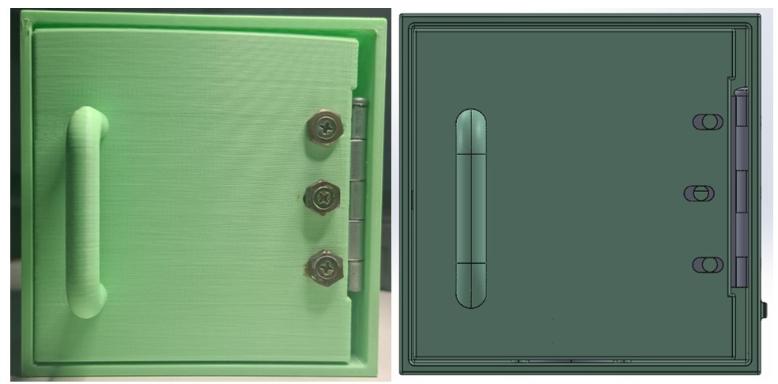

# Embedded Mini Projects

Small embedded projects built around the ESP32 of the PAT-DAELN v2.1 board, from the Microcontroller Systems course at UTFPR.

| Project | Description | Folder |
|---|---|---|
| Electronic safe | Password-protected safe with a 5-state finite state machine, a stepper-driven locking hook and an OLED interface, meeting all 14 lab requirements | [electronic-safe](electronic-safe/) |
| Vehicle prototype | Parking sensor, automatic headlights, air conditioning and power window in one firmware, with a PLA body inspired by the Volkswagen Type 2 | [vehicle-prototype](vehicle-prototype/) |

## Attribution and usage

This repository is shared for portfolio and educational purposes. Both projects are lab work by Felipe Martins and Gabriela Bosco Azevedo. No license is granted for reuse or redistribution of the images or text. If you want to use any of it, please contact me on [LinkedIn](https://www.linkedin.com/in/felipe-m-k-m-martins).

## Author

Felipe Martins, Mechatronics Engineering student at UTFPR, double degree at ENSTA.
[LinkedIn](https://www.linkedin.com/in/felipe-m-k-m-martins)
