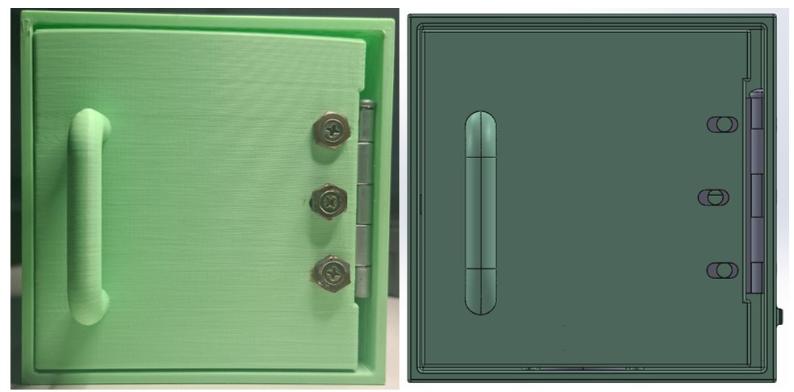
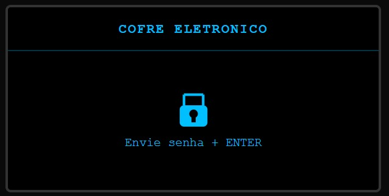
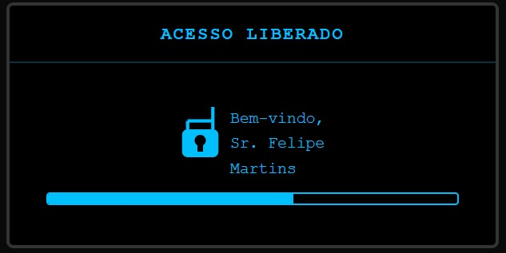
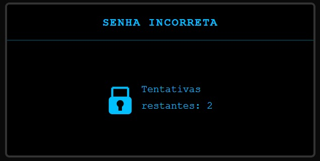
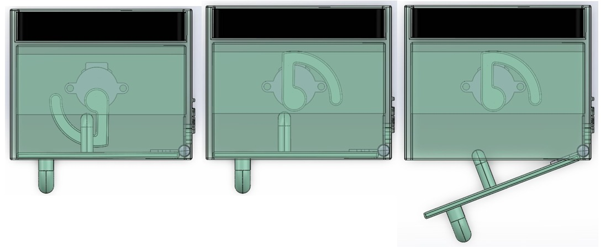
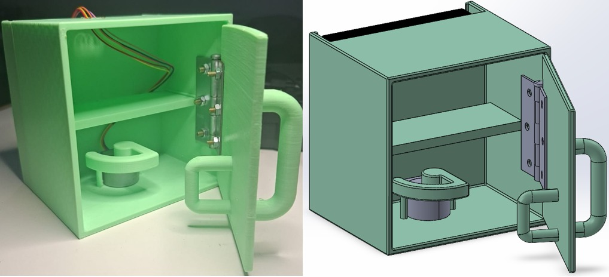
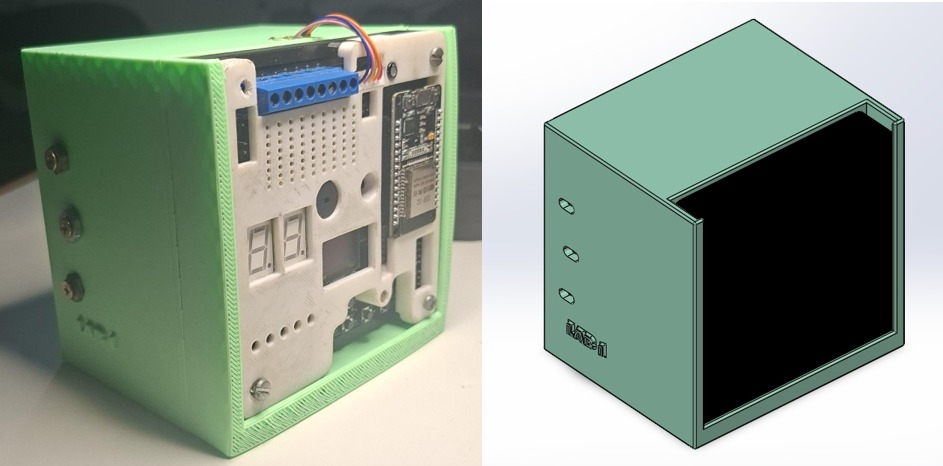

# ESP32 Electronic Safe

Electronic safe with password access over UART, a 28BYJ-48 stepper motor that turns a locking hook, an OLED interface and a 3D printed ABS case. Built on the ESP32 of the PAT-DAELN v2.1 board.

## Overview

Lab project of the Microcontroller Systems course (ELN76B) at UTFPR, 2026. The user types a 6-digit password in the serial monitor. A correct password turns the hook 180° to open the safe, shows the user's name on the OLED and closes again after a 5 s countdown. Wrong passwords are counted, and the third consecutive wrong password triggers an alarm. All 14 requirements of the lab assignment were met.

## Hardware

| Part | Use |
|---|---|
| ESP32-WROOM-32 on PAT-DAELN v2.1 | Controller, powered over USB |
| 28BYJ-48 stepper motor with the board's ULN2803 driver | Turns the locking hook |
| SSD1306 OLED, 128 x 64, I2C | User interface |
| Active buzzer | Key beeps, success signal and alarm |
| 120 x 120 x 120 mm ABS case | Printed in FDM, with hinged door and handle |

## Firmware design

The firmware is a finite state machine with five states:

| State | Waits for |
|---|---|
| `DESLIGADO` | the `LIGAR` command |
| `AGUARDANDO` | a password |
| `MENU_USUARIO` | which user's password to change |
| `MENU_NOVA_SENHA` | the new password |
| `MENU_CONFIRMA` | the new password again |

- **Users:** two user passwords and a fixed master password. The master password opens an admin menu that changes either user password, with double confirmation.
- **Wrong password:** a 60 ms beep and the number of attempts left on the OLED, then 2 s of inactivity. On the third consecutive error the buzzer sounds for 3 s and the OLED shows an alert.
- **Motor:** full-step drive, 1024 steps for 180° at 3 ms per step, about 3.1 s to open or close. The coils stay energized after closing to hold the hook in place.
- **OLED:** pixel-art icons drawn with graphic primitives, and a progress bar for the 5 s countdown.
- **Board quirks handled in firmware:** GPIO 5 and 15 rise during boot and are driven low first thing in `setup()`, and the auxiliary transistors of the board are switched off after every OLED update because the I2C traffic turns them on.

| Waiting for password | Access granted | Wrong password |
|---|---|---|
|  |  |  |

## Mechanical design

The case was modeled in SolidWorks and printed in ABS. The lock is a hook mounted directly on the motor shaft: turning 180° clockwise engages a bar fixed to the door, and turning back releases it. An internal shelf separates the motor area from the electronics, and the board sits at the back with the OLED facing out.

| Inside | Back |
|---|---|
|  |  |

## Measured parameters

| Parameter | Value |
|---|---|
| Supply | 5.0 V (USB) |
| Opening and closing time (180°) | about 3.1 s each |
| Steps per 180° | 1024, 3 ms apart |
| UART | 115200 baud |
| Password length | 6 digits |
| Open period before closing | 5 s |
| Alarm after the third wrong password | 3 s |

## Files

The firmware is not included in this repository; this folder documents the design and the results.

## Credits

Lab project of the Microcontroller Systems course at UTFPR by Felipe Martins and Gabriela Bosco Azevedo.
