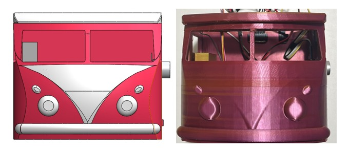
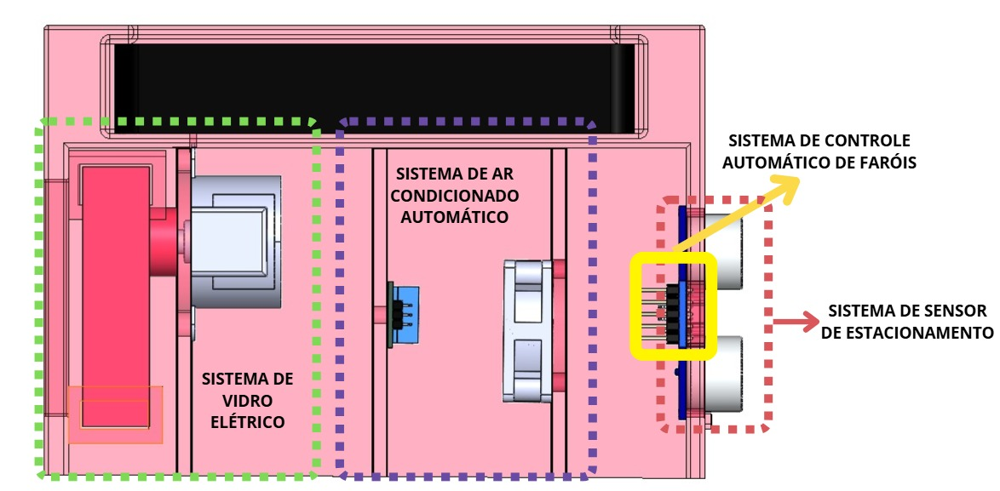
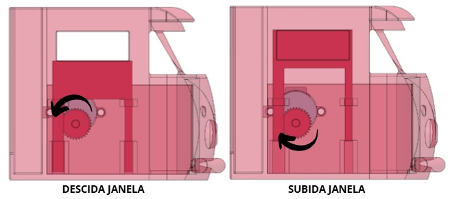
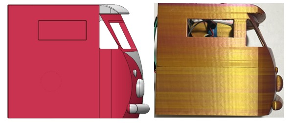
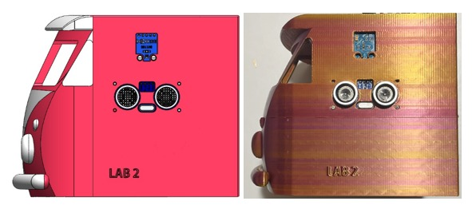
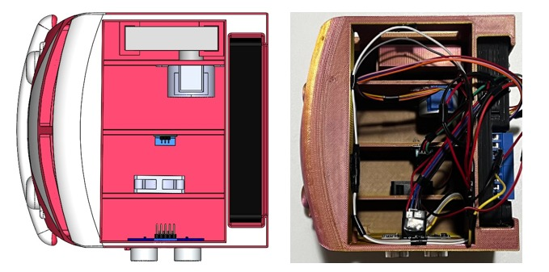

# ESP32 Vehicle Prototype

Bench prototype that simulates four automotive functions on the ESP32 of the PAT-DAELN v2.1 board: parking sensor, automatic headlights, automatic air conditioning and power window. The 3D printed PLA body is inspired by the Volkswagen Type 2, with each side dedicated to one subsystem.

## Overview

Lab project of the Microcontroller Systems course (ELN76B) at UTFPR, 2026. The four subsystems run in a single firmware. The S4 button cycles through four OLED screens (headlights, windows, air conditioning, parking), the S5 and S6 buttons open and close the window from any screen, and the air conditioning threshold is set over UART. Every subsystem passed its bench test.

## Subsystems

| Subsystem | Hardware | Behavior |
|---|---|---|
| Parking sensor | HC-SR04 (ECHO through a 1 kΩ / 2 kΩ divider), 5 LEDs, buzzer | Five distance zones instead of the three required, average of three valid readings, zone changes only after two consecutive readings agree |
| Automatic headlights | BH1750 light sensor (I2C, 0x23) | LEDs turn on below 50 lux, threshold found experimentally |
| Air conditioning | DHT11, 30 mm DC fan through the L293D | Fan on above the threshold (25 °C by default, changeable over UART), DHT11 read every 2 s |
| Power window | 28BYJ-48 with a printed rack and pinion | 694 steps (about 122°) move the window about 20 mm, one press opens or closes fully |

Parking zones:

| Zone | Distance | LEDs | Buzzer |
|---|---|---|---|
| Free | over 80 cm | 1 | off |
| Far | 50 to 80 cm | 2 | 50 ms every 900 ms |
| Medium | 25 to 50 cm | 3 | 50 ms every 400 ms |
| Near | 10 to 25 cm | 4 | 50 ms every 180 ms |
| Critical | 10 cm or less | 5 | continuous |

## Design notes

- **Shared pin:** GPIO 17 drives both the fan (L293D) and the fifth parking LED, so the firmware suspends the fan while the parking screen is active.
- **Boot pins:** GPIO 15 and GPIO 12 are driven low first thing in `setup()`, which allows GPIO 12 to be used as the HC-SR04 trigger.
- **I2C side effect:** the auxiliary transistors of the board are switched off after every OLED update, without touching the headlight LEDs.
- **Power:** 3.3 V from the board for the BH1750, DHT11 and OLED, and an external 5 V supply for the HC-SR04, the fan and the stepper motor, with common ground.

## Mechanical design

The body was modeled in SolidWorks and printed in PLA, 150 x 140 x 120 mm and about 200 g. The power window uses a 23-tooth rack driven by a 24-tooth gear on the motor shaft, with printed guides that act as end stops.

| Window mechanism | Right side (window opening) |
|---|---|
|  |  |
| **Left side (HC-SR04 and BH1750)** | **Top (PAT-DAELN board)** |
|  |  |

## Limitations

- The fan is only switched on and off, without PWM.
- The window has no physical end switches; its position comes only from step counting.
- Each parking reading blocks the loop for up to 900 ms, pausing UART, the DHT11 and the S4 button.
- The fan and the parking sensor cannot work at the same time because of the shared GPIO 17.

## Files

The firmware is not included in this repository; this folder documents the design and the results.

## Credits

Lab project of the Microcontroller Systems course at UTFPR by Felipe Martins and Gabriela Bosco Azevedo.
